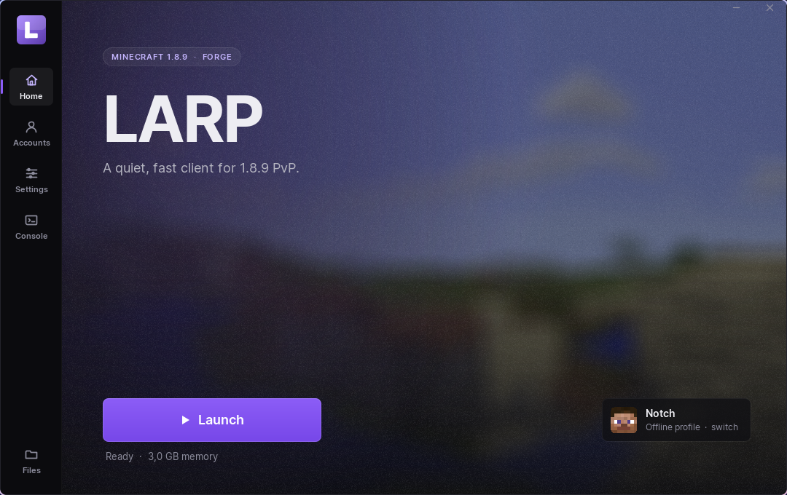
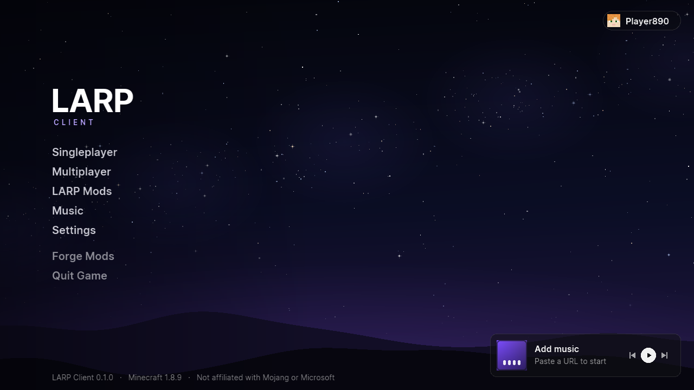
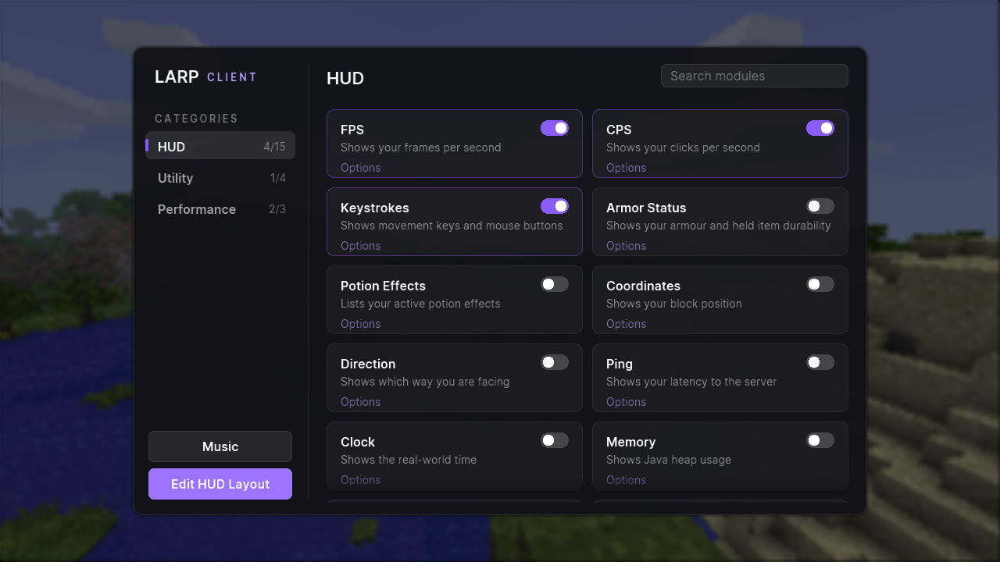
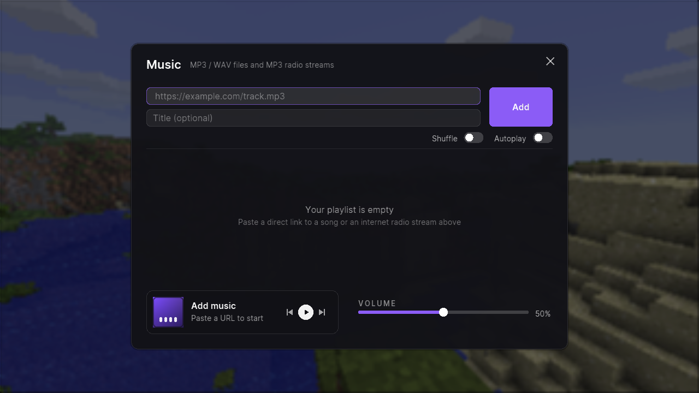

# LARP Client

A lightweight, Linux-first **PvP client for Minecraft 1.8.9**. It comes in two parts:

- **LARP Launcher** is a desktop app. Pick an account and click **Launch**. It downloads Minecraft 1.8.9,
  Forge, a Java 8 runtime (if you don't have one) and the LARP mod, then starts the game.
- **LARP mod** is a Forge 1.8.9 mod with a custom main menu, a music player, HUD mods, zoom, freelook and
  performance tweaks.

<p align="center">
  
  
</p>
<p align="center">
  
  
</p>

> LARP Client only provides **legitimate cosmetic, informational and performance features**.
> It does not and will not contain combat cheats (killaura, reach, velocity, autoclicker, …).
> Features that specific servers ask clients not to provide (e.g. Freelook on Hypixel) are
> disabled automatically on those servers.

## Features

**Launcher**
- One click: installs and verifies everything (SHA-1 checked, parallel, resumable) and launches.
- Offline (non-premium) profiles: pick a username and play.
- Memory, resolution, Java and JVM argument settings; live game console.
- Headless mode: `larp-client --launch --offline Steve`.

**In game**
| Category | Modules |
|---|---|
| **Menus** | Starry-sky main menu (vanilla menus too) · mod menu (Right Shift or pause menu → LARP Mods) · HUD editor · music player |
| **HUD** | FPS · CPS · Keystrokes · Armor Status · Potion Effects · Coordinates · Direction · Ping · Clock · Memory · Combo Counter · Reach Display · Server Address · Now Playing · Toggle Sprint |
| **Utility** | Zoom (smooth, scroll-adjustable) · Freelook · Fullbright · No Hurt Cam |
| **Performance** | Fast Render (no glGetError stalls, smooth menus) · Background FPS Limit · Particle Limiter · Entity Culling · tuned G1 JVM flags · threaded OpenGL on Linux · fast first-run video settings |
| **Display** | Fullscreen that actually works on Wayland (Hyprland, Sway, KDE, GNOME) and X11: F11 asks the compositor for fullscreen instead of LWJGL's broken XWayland path |
| **HUD Theme** | Modern rounded HUD with Inter text (or Classic), adjustable opacity, corners and accent |

**Music player**: paste any direct **MP3 / WAV** link or an **MP3 internet-radio stream**. Control it
from the main menu or from *Mod menu → Music*. It supports shuffle, autoplay, volume and a "Now Playing" HUD.

Default keys: `Right Shift` menu · `C` zoom · `Left Alt` freelook. You can change all of them in
*Options → Controls → LARP Client* or in the mod menu.

## Install

**Quick start:** see [INSTALL.md](INSTALL.md). Download `larp-client-<ver>-linux-x86_64` from Releases, make it
executable, run it, add a username, and click Launch. LARP Client targets Linux on Hyprland; the launcher is a
native program (Rust), so no Java is needed to run it. The game's Java 8 is found or downloaded automatically.

### Linux from source

```sh
git clone https://github.com/ogjulius/larp-client && cd larp-client
./scripts/install-linux.sh      # needs JDK 8 + 17 (to build the mod) and Rust
```

This adds **LARP Client** to your application menu and a `larp-client` command.
Game files live in `~/.local/share/larpclient` and settings in `~/.config/larpclient` (XDG dirs honoured).

### Using only the mod

`mod/build/libs/larpclient-<ver>.jar` is a normal Forge 1.8.9 (`11.15.1.2318`) mod. Drop it into
`.minecraft/mods/` of any launcher.

## Building

```sh
sudo pacman -S --needed jdk8-openjdk jdk17-openjdk rust   # Arch / CachyOS
JAVA_HOME=/usr/lib/jvm/java-17-openjdk ./gradlew build :bundle:rustBundle   # the mod + launcher bundle
cargo build --release -p larp-cli --manifest-path launcher-rs/Cargo.toml   # the launcher
```

See [DEVELOPMENT.md](DEVELOPMENT.md) for the architecture and how to contribute.

## Contributors

- **ogjulius**: creator and main contributor

## License

[MIT](LICENSE). The mod bundles [JLayer](http://www.javazoom.net/javalayer/javalayer.html) (LGPL 2.1) for MP3
decoding. Build tooling is derived from [nea89o/Forge1.8.9Template](https://github.com/nea89o/Forge1.8.9Template)
(public domain). Minecraft is a trademark of Mojang AB. This project is not affiliated with Mojang or Microsoft.
